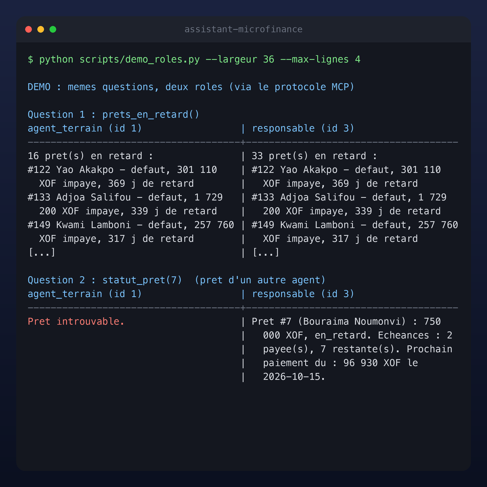
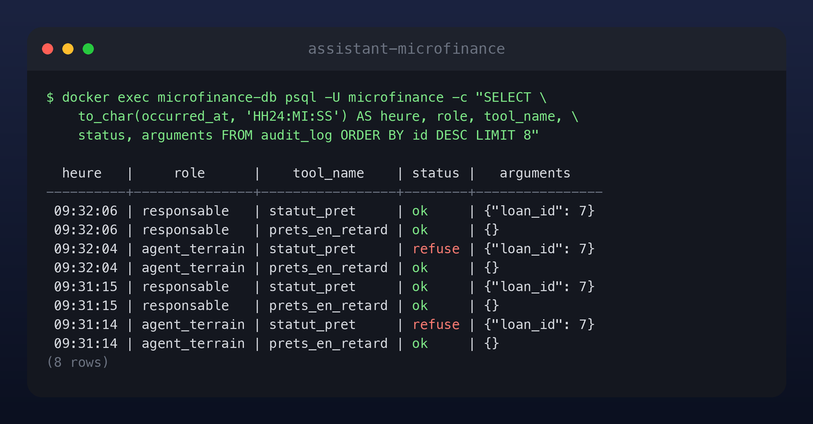

# Assistant IA microfinance

Projet vitrine : un assistant IA qui repond a des questions sur un portefeuille de microfinance, via un serveur MCP, avec permissions par role et journal d'audit. Donnees 100 % synthetiques.

## Demarrage

```bash
docker compose up -d
python3 -m venv .venv && source .venv/bin/activate
pip install -r requirements.txt
python data/generate.py
```

> **Dev uniquement :** la base Docker utilise les identifiants `microfinance` / `microfinance` (utilisateur, mot de passe, base), definis dans `docker-compose.yml`. Ils ne servent qu'au developpement local : le port n'est expose que sur `127.0.0.1:5433`. Ne jamais reutiliser ces identifiants ailleurs.

## Serveur MCP

Lancement (transport stdio) :

```bash
MCP_USER_ID=3 python mcp_server/server.py
```

`MCP_USER_ID` est l'id d'un utilisateur de la table `app_users` : 1 et 2 agents terrain, 3 responsable, 4 auditeur. Le role est lu en base par le serveur, jamais fourni par le modele. La base est jointe sur `localhost:5433` (surcharge via `DATABASE_URL`).

### Permissions

| Outil | agent_terrain | responsable | auditeur |
|---|---|---|---|
| `rechercher_client(nom)` | clients ayant un de ses prets | tout | tout |
| `statut_pret(loan_id)` | ses prets (sinon « Pret introuvable. ») | tout | tout |
| `prets_en_retard()` | ses prets | tout | tout |
| `journal_audit(limite)` | refuse | refuse | oui |

Chaque appel, y compris refuse ou en erreur, ajoute une ligne dans `audit_log`.

> **Limite connue :** l'identite vient d'une variable d'environnement fixee par celui qui configure le client. Ce n'est pas une authentification : le modele ne peut pas changer de role, mais quiconque edite la configuration peut choisir n'importe quel id. Une vraie authentification (jeton, OAuth) reste a faire.

### Brancher un client MCP

Remplacer `/chemin/vers/assistant-microfinance` par le chemin absolu du projet (le venv doit etre installe et la base demarree).

Claude Code :

```bash
claude mcp add microfinance -e MCP_USER_ID=3 -- /chemin/vers/assistant-microfinance/.venv/bin/python /chemin/vers/assistant-microfinance/mcp_server/server.py
```

Autre client MCP (Claude Desktop, etc.), fichier de configuration JSON :

```json
{
  "mcpServers": {
    "microfinance": {
      "command": "/chemin/vers/assistant-microfinance/.venv/bin/python",
      "args": ["/chemin/vers/assistant-microfinance/mcp_server/server.py"],
      "env": { "MCP_USER_ID": "3" }
    }
  }
}
```

Pour tester un autre role, changer `MCP_USER_ID` (un serveur = une identite).

## Exemple

Memes questions, deux roles, via le protocole MCP (sortie reelle de `python scripts/demo_roles.py`, donnees fictives generees par `data/generate.py`, capturee le 2026-11-15) :

```text
DEMO : memes questions, deux roles (via le protocole MCP)

Question 1 : prets_en_retard()
agent_terrain (id 1)                                           | responsable (id 3)
---------------------------------------------------------------+---------------------------------------------------------------
16 pret(s) en retard :                                         | 33 pret(s) en retard :
#122 Yao Akakpo - defaut, 301 110 XOF impaye, 369 j de retard  | #122 Yao Akakpo - defaut, 301 110 XOF impaye, 369 j de retard
#133 Adjoa Salifou - defaut, 1 729 200 XOF impaye, 339 j de    | #133 Adjoa Salifou - defaut, 1 729 200 XOF impaye, 339 j de
  retard                                                       |   retard
#149 Kwami Lamboni - defaut, 257 760 XOF impaye, 317 j de      | #149 Kwami Lamboni - defaut, 257 760 XOF impaye, 317 j de
  retard                                                       |   retard
#155 Ayité Kassegne - defaut, 1 182 200 XOF impaye, 315 j de   | #155 Ayité Kassegne - defaut, 1 182 200 XOF impaye, 315 j de
  retard                                                       |   retard
#106 Safiatou Salifou - defaut, 314 860 XOF impaye, 225 j de   | #65 Delali Noumonvi - defaut, 1 194 440 XOF impaye, 264 j de
  retard                                                       |   retard
#193 Ornella Agbodjan - defaut, 366 170 XOF impaye, 210 j de   | #83 Alidou Ayivi - defaut, 829 880 XOF impaye, 228 j de retard
  retard                                                       | #106 Safiatou Salifou - defaut, 314 860 XOF impaye, 225 j de
#165 Dzifa Quashie - defaut, 1 106 320 XOF impaye, 114 j de    |   retard
  retard                                                       | #193 Ornella Agbodjan - defaut, 366 170 XOF impaye, 210 j de
#32 Kokoé Salifou - defaut, 492 200 XOF impaye, 112 j de       |   retard
  retard                                                       | #192 Fatoumata Lamboni - defaut, 2 965 000 XOF impaye, 148 j
#2 Ornella Amegah - en_retard, 250 060 XOF impaye, 42 j de     |   de retard
  retard                                                       | #126 Moussa Awesso - defaut, 835 450 XOF impaye, 145 j de
#29 Yao Sossou - en_retard, 197 180 XOF impaye, 39 j de retard |   retard
... et 6 autre(s).                                             | ... et 23 autre(s).

Question 2 : statut_pret(7)  (pret d'un autre agent)
agent_terrain (id 1)                                           | responsable (id 3)
---------------------------------------------------------------+---------------------------------------------------------------
Pret introuvable.                                              | Pret #7 (Bouraima Noumonvi) : 750 000 XOF, en_retard.
                                                               |   Echeances : 2 payee(s), 7 restante(s). Prochain paiement du
                                                               |   : 96 930 XOF le 2026-10-15.
```

L'agent terrain ne voit que son portefeuille et recoit « Pret introuvable. » pour le pret d'un autre agent ; le responsable voit tout. Le script ecrit dans `audit_log` de la base de dev.



Le journal d'audit garde la trace de chaque appel, refus compris :



Les images sont generees a partir des vraies sorties des commandes (rien n'est retape) :

```bash
pip install -r requirements-dev.txt
python scripts/make_screenshots.py
```

## Tests

```bash
source .venv/bin/activate && python -m pytest
```

Test de bout en bout (serveur lance en stdio, pilote par le client MCP du SDK) :

```bash
python -m pytest tests/test_e2e_mcp.py
```

La base Docker doit tourner (port 5433). Les tests creent une base separee `microfinance_test`, la remplissent de donnees fictives puis la suppriment : la base de dev n'est pas modifiee.

## Structure

- `db/schema.sql` : schema PostgreSQL (clients, prets, remboursements, utilisateurs, journal d'audit, documents pour le RAG)
- `data/generate.py` : generateur de donnees fictives
- `mcp_server/server.py` : serveur MCP (rechercher_client, statut_pret, prets_en_retard, journal_audit)
- `tests/` : tests pytest (permissions par role, bout en bout via MCP)
- `scripts/demo_roles.py` : demo des roles via le protocole MCP
- `scripts/make_screenshots.py` : regenere les captures de `docs/images/`
- `evals/` : jeu de questions-tests (a venir)
